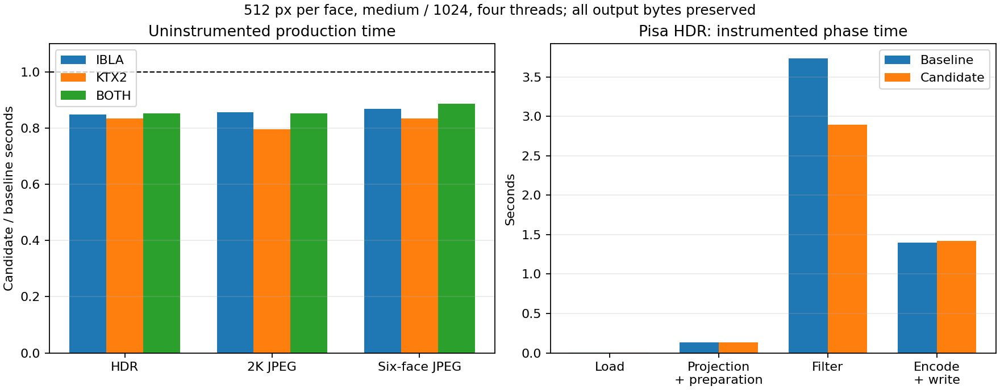

# Filter precomputation acceptance

## Decision

Prepare each cubemap filtering sample's source LOD, neighboring source mip
indices and interpolation fraction once per filtering pass. These quantities
depend on the kernel PDF, actual sample count and source mip chain, and are
constant across output pixels. The prepared kernel is local to the pass; it is
not shared across environments or retained as a persistent cache.

The existing source-footprint formula, clamps, near-integer interpolation cutoff,
directions, GGX weights, sample order and floating-point accumulation order are
unchanged. Default quality, quadratic budgets and the complete output mip chain
are preserved. There is no new public parameter, API, dependency, format change
or consumer migration in this optimization. Runtime queries continue to use the
[existing integration contract](runtime-contract.md).

The general sample kernel cache still stores directions and PDFs. The BRDF LUT
uses that unchanged representation. A second, temporary O(sample-count) vector
holds prepared cubemap samples: about 40 KiB for 1024 samples on the measured
64-bit build. It is allocated once per filtering pass, with no per-pixel
allocation. This small storage cost removes repeated `log2`, clamp, floor and
mip-index work from the pixel/sample loop.

## Reproducible comparison

The baseline is `a306d63`, after decoded-input reuse and float-buffer ownership
transfers. Its previously accepted production executable and source fingerprints
were checked against the [prior evidence](pipeline-performance-evidence.json)
before freezing the executable. The frozen SHA-256 is
`04819e6b028d93a7ad24359be01dbcd9f2513a5a14a2410032cf67befab4d800`.
The candidate SHA-256 is
`b2be68709a2417fef0a96f7b8c4c97986fd9fd26e60200fde3d44a5d1476bdc1`.

The [private study](../scripts/lod-performance/README.md) first measures
specular-only and irradiance-only Pisa HDR/KTX2 jobs. Their median time ratios
are 0.8324 and 0.8735, respectively. Both pass exact file parity. The wider
production matrix then covers Pisa HDR, Spruit Sunrise 2K JPEG and Bridge2
six-face JPEG, independently for IBLA, KTX2 and both. Each job uses 512-pixel
specular faces, all three targets, default medium quality, 1024 requested
samples, a complete chain and four Rayon threads. Both executables receive two
warmups, followed by seven alternating paired rounds per cell. Every pair must
emit files with identical SHA-256 and length. Executables remain frozen during
measurement. This uses a fresh incremental baseline, without reusing the earlier
optimization's performance allowance.

Separate instrumented builds profile Pisa HDR with one warmup and three trials.
Their output hashes must match the production binary. Exclusive phase grouping
avoids double-counting nested calls. Phase timing is diagnostic; acceptance uses
the uninstrumented paired jobs. Process peaks use Windows Job Objects' private
commit high-water marks, not physical resident memory. Phase process peaks are
sampled and can miss short spikes. Requested-live Rust heap excludes native
allocations, allocator overhead and transient realloc buffers.

## Production results

Time ratios are candidate/baseline. Intervals use 2000 deterministic paired
bootstrap resamples as a noise diagnostic; host drift and correlated noise can
remain. All nine intervals are below parity. No cell required fifteen-round
confirmation. The reused acceptance diagnostics allow at most 5% time and 10%
process-peak growth; all nine pass by a wide margin and remain below the broader
two-times bake-time limit.

| Input | Format | Baseline seconds | Candidate seconds | Time ratio (95% interval) | Peak MiB, baseline -> candidate |
| --- | --- | ---: | ---: | ---: | ---: |
| Pisa HDR | IBLA | 4.694 | 3.984 | 0.8488x (0.8223-0.8598) | 61.58 -> 61.66 |
| Pisa HDR | KTX2 | 4.346 | 3.623 | 0.8337x (0.8245-0.8394) | 64.16 -> 64.23 |
| Pisa HDR | Both | 5.334 | 4.546 | 0.8524x (0.8211-0.8840) | 64.81 -> 64.56 |
| 2K JPEG | IBLA | 5.181 | 4.439 | 0.8567x (0.7811-0.8834) | 79.68 -> 79.73 |
| 2K JPEG | KTX2 | 5.221 | 4.152 | 0.7953x (0.7440-0.8659) | 82.24 -> 82.30 |
| 2K JPEG | Both | 5.368 | 4.574 | 0.8522x (0.8360-0.8756) | 82.67 -> 82.66 |
| Six-face JPEG | IBLA | 5.067 | 4.398 | 0.8680x (0.8480-0.8788) | 127.79 -> 127.81 |
| Six-face JPEG | KTX2 | 4.655 | 3.885 | 0.8346x (0.8016-0.8502) | 130.61 -> 130.64 |
| Six-face JPEG | Both | 5.445 | 4.829 | 0.8870x (0.8527-0.9064) | 131.73 -> 131.65 |

Median elapsed time falls by **11.3% to 20.5%**. Peak private commit stays
effectively flat: median changes range from -0.38% to +0.13%. Output sizes and
hashes are unchanged. This is an incremental improvement over decoded-input
reuse, rather than a comparison against the earlier duplicate-load version.

The representative Pisa HDR `both` profile attributes the change to filtering:

| Phase | Seconds, baseline -> candidate | Requested-live Rust heap peak MiB |
| --- | ---: | ---: |
| Source loading | 0.0068 -> 0.0066 | 12.00 -> 12.00 |
| Projection + source mips/borders | 0.1312 -> 0.1316 | 48.32 -> 48.32 |
| Specular + irradiance + LUT filtering | 3.7320 -> 2.8928 | 60.39 -> 60.43 |
| Encoding, assembly and writes | 1.3949 -> 1.4222 | 58.56 -> 58.56 |

Within filtering, specular takes 3.4657 -> 2.6813 seconds and irradiance takes
0.2506 -> 0.2003 seconds. Both versions decode the source once. The roughly
40 KiB filtering heap increase matches the temporary prepared kernel. These
three-trial, instrumented medians support the attribution, not a separate
production speed claim. Unchanged stages can still differ through host noise
and instrumentation. Group medians need not sum to the median process time.

The [compact evidence](lod-performance-evidence.json) retains original paired
samples, intervals, the empty confirmation record, pilot results, output hashes,
source/binary identities, compatibility results and phase measurements. The
hashed full phase traces and build logs remain in the local study directory.

## Correctness and limits

A deterministic core test compares GGX and Lambertian float results bit for bit
against the frozen scalar path. It covers zero/one/low sample counts, multiple
roughness values, singleton and NPOT source chains, axes, edges, corners and an
arbitrary direction, with varying HDR and negative source values. This detects
arithmetic and interpolation changes before output encoding could hide them.

The additional CLI compatibility matrix checks sizes 1, 3, 31 and 255, rotated
six-face input, irradiance larger than the specular base, an explicitly truncated
chain with seven requested samples, and irradiance-only/LUT-only output. Both
real TypeScript parsers validate the complete output pairs. No consumer assets
are overwritten and no version is published by this work.

All 124 Rust tests pass locally on Windows (32 CLI/integration, 69 core and
23 writer), including the new float parity oracle. Formatting, Clippy,
JavaScript/JSON syntax and workspace TypeScript checks also pass.

## Cross-platform integration

Fresh [CI #60](https://github.com/shawn0326/ibl-baker/actions/runs/40266949701)
passes on source commit `4e2753253ee07695e1b6d5dd82ad0495a24f9ecc` in
[draft PR #27](https://github.com/shawn0326/ibl-baker/pull/27):

| Check | Result | Scope |
| --- | --- | --- |
| Linux Quality | Success | Rust tests/Clippy/format, TS, release tooling, generated fixtures, both loaders, site, npm CLI and archive consumers |
| Windows x64 Cargo | Success | Offline locked workspace build check and pnpm/Cargo source consistency |
| macOS arm64 Cargo | Success | Offline locked workspace build check and pnpm/Cargo source consistency |
| CI Gate | Success | Required-check aggregation |

Pages deployment is intentionally skipped for pull requests. The Windows/macOS
jobs are compile checks; they do not claim runtime/performance acceptance on
those platforms. The CI record is separate from the native benchmark evidence.
This follow-up documentation does not change the tested production sources.

The performance scope is the measured Windows host, four threads and 512-pixel
output faces. Exact output parity establishes image equivalence for the tested
matrix; speed improvements on other hosts, sizes or inputs require their own
measurements. Cross-platform build/test evidence is tracked separately from
these native timings.
