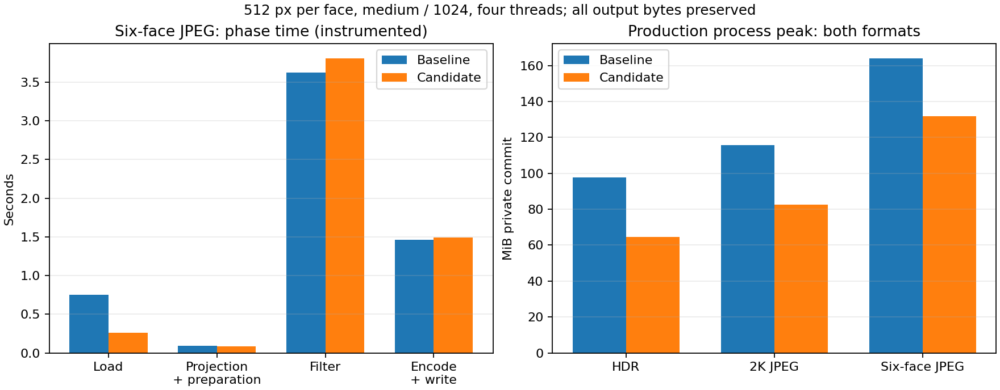

# Pipeline performance acceptance

## Decision

Reuse one decoded environment across a CLI job's selected targets. Move the
projected base cubemap into the source mip chain, then transfer source mip zero
into the completed specular output after filtering. Borrow LUT PNG bytes when
writing instead of cloning them.

Default quality, sample allocation, projection/filter arithmetic, mip layout,
IBLA v1, BC6H UFLOAT + zstd, file names, target order and clipping reports are
unchanged. Tested output files are byte-identical to the frozen baseline. There
is no new public CLI parameter, dependency or runtime query.

Rust gains the additive opaque `LoadedEnvironment` API for decoded-input reuse.
Existing functions and `BakeOptions` retain their signatures and fields. The
[core README](../crates/ibl_core/README.md#reuse-decoded-inputs) documents ownership
and lifetime. This is per-job input reuse, not a persistent projection cache.

## Measurement

The baseline is `125ea90`, after shared multi-format baking and the 1x1 BC6H
repair. Its frozen Windows release CLI SHA-256 is
`bf2a287bc58a583cb282103a7dc166369ad7c38f9d7d44abb512a1b3a780ab3a`.
The candidate SHA-256 is
`04819e6b028d93a7ad24359be01dbcd9f2513a5a14a2410032cf67befab4d800`.

The [private harness](../scripts/pipeline-performance/README.md) uses Pisa HDR,
Spruit Sunrise 2K JPEG and Bridge2 six-face JPEG inputs. Native measurements use
512-pixel output faces, default medium quality, 1024 requested samples, a complete
chain, all three targets and four Rayon threads. IBLA, KTX2 and both are measured
independently with two warmups and seven alternating paired rounds. One initially
noisy HDR/KTX2 cell receives fifteen rounds; its original data is retained.

Phase profiles use isolated instrumented executables with one warmup and three
trials, requiring identical files against the uninstrumented baseline. Loading,
projection, source mip/border preparation, specular/irradiance/LUT filtering,
PNG and container assembly, KTX2 packing/BC6H/zstd and file writes are separated.
Nested phase times are not added twice.

Phase heap peaks count absolute requested-live Rust allocations, including
retained inputs. They exclude native malloc, arena overhead and transient
old/new realloc buffers. Phase process private commit is sampled at boundaries
and by a thread requesting a 1 ms sleep; short peaks may be missed. These are
diagnostics, not exact native phase high-water marks or additive memory costs.
Separate uninstrumented Windows Job Object measurements retain actual peak
process commit after exit. Instrumented timing is not used to certify speed.

## Results

The final uninstrumented medians are below. Peak values are medians of each
process's retained peak private commit, in MiB; time ratios are candidate/baseline.

| Input | Format | Baseline seconds | Candidate seconds | Time ratio | Peak MiB, baseline -> candidate |
| --- | --- | ---: | ---: | ---: | ---: |
| Pisa HDR | IBLA | 4.922 | 4.847 | 0.9847x | 97.67 -> 61.56 |
| Pisa HDR | KTX2 | 4.426 | 4.415 | 0.9976x | 97.69 -> 64.19 |
| Pisa HDR | Both | 5.391 | 5.357 | 0.9937x | 97.70 -> 64.65 |
| 2K JPEG | IBLA | 4.855 | 4.682 | 0.9644x | 115.79 -> 79.64 |
| 2K JPEG | KTX2 | 4.565 | 4.469 | 0.9789x | 115.79 -> 82.24 |
| 2K JPEG | Both | 5.274 | 5.079 | 0.9631x | 115.79 -> 82.67 |
| Six-face JPEG | IBLA | 5.389 | 4.860 | 0.9019x | 163.89 -> 127.80 |
| Six-face JPEG | KTX2 | 4.979 | 4.456 | 0.8948x | 163.87 -> 130.62 |
| Six-face JPEG | Both | 6.013 | 5.523 | 0.9185x | 163.88 -> 131.62 |

Peak process commit falls by **19.7% to 37.0%**. The six-face JPEG has a stable
8.1% to 10.5% speed improvement in all three formats. The 2K JPEG has stable
3.6% to 3.7% gains for IBLA/both. Its KTX2 point estimate improves by 2.1%, but
the time interval crosses parity. HDR time is effectively flat: its confidence
intervals also cross parity. Do not interpret small median differences as
universal speedups. All nine final cells satisfy the reused timing/memory noise
diagnostics; the HDR/KTX2 row uses the fifteen-round confirmation.

The six-face JPEG `both` phase profile illustrates where work and live memory go:

| Phase | Seconds, baseline -> candidate | Rust heap peak MiB | Sampled private commit peak MiB |
| --- | ---: | ---: | ---: |
| Source loading | 0.750 -> 0.260 | 84.03 -> 84.00 | 85.93 -> 85.30 |
| Projection + source mips/borders | 0.095 -> 0.088 | 132.32 -> 114.32 | 134.62 -> 116.26 |
| Specular + irradiance + LUT filtering | 3.625 -> 3.806 | 162.39 -> 126.39 | 163.97 -> 127.81 |
| Encoding, assembly and writes | 1.461 -> 1.493 | 73.39 -> 124.63 | 75.41 -> 129.91 |

These are three-trial instrumented phase medians, not paired speed comparisons.
Tracing perturbs allocation costs, host drift remains, and consuming the filter
context moves its cleanup inside the candidate's filtering call. The observed
filter-time increase is not a claim about changed integration work; production
speed conclusions use the separate paired runs. Group medians need not sum to
the median process time. CLI setup/glue is recorded separately as `other`.

Full decode count falls from three to one. Filtering's requested-live heap peak
falls by exactly 36 MiB for every measured input; the input-dependent process
commit reduction is measured separately above. Encoding memory increases because
the decoded source remains live for later targets, as discussed below.

The [compact evidence](pipeline-performance-evidence.json) retains raw timing and
memory samples, confidence intervals, original/confirmation results, phase
summaries, grouped measurements, output hashes, source/binary identities and
compatibility results. Full phase traces and logs remain in the hashed local
study directory.

## Why these changes

The default three-target CLI previously decoded the source three times,
including once on the LUT path even though its pixels do not use the environment.
The CLI now validates/decodes once and passes the immutable decoded source to
each target. Single-target jobs still validate their input; LUT input/error
semantics have not been bypassed.

The filtering context previously owned a base cube, cloned it into the source
mips, and cloned it again into specular mip zero while filtering was active.
The two full-resolution float copies are removed with ownership transfers.
At 512, their requested storage is exactly
`2 * 6 * 512 * 512 * sizeof(Vec3) = 36 MiB`. Irradiance also avoids the redundant
base/source-mip copy. Every sample still sees the same source pixels and mips.

Decoded-input reuse retains the source during encoding. This increases local
encoding-phase live memory, especially for six large input faces. It is a
deliberate tradeoff: duplicate decodes disappear, and overall measured peaks
still fall because the larger filtering copies are gone. It would be incorrect
to claim that every phase uses less memory. A single-target Rust caller can use
`bake_to_cubemap` or drop its `LoadedEnvironment` before encoding.

Projection/source preparation remains per target. Retaining all direction grids,
source mips and borders through encoding just to share a short projection would
extend the lifetime of sizable working buffers. KTX2 still repacks the float
chain for the existing writer API, and IBLA serialization still normalizes its
container. Their measured costs do not justify widening this change into new
writer APIs or a general cache. Filtering remains the dominant CPU workload;
no precision or sampling-model changes are included.

## Contract validation and scope

Every paired production run checks all emitted files by SHA-256 and byte length.
The three `both` profile cases also check all five files against the frozen
production binary. An additional matrix covers sizes 1, 3, 31 and 255, a rotated
six-face input with irradiance larger than the specular size, a freshly truncated
chain with seven requested samples, and irradiance-only/LUT-only selections.
Both real TypeScript parsers check the complete cubemap output pairs.

All 123 Rust tests pass (32 CLI/integration, 68 core, 23 writer), including report
and partial-success regressions. Format, Clippy, JavaScript syntax and workspace
TypeScript checks also pass. No profiling allocator, OS hook or instrumentation
dependency is included in the production build.

The existing workspace tests cover format topology, reports, ranges, low budgets
and partial write failures. A new ownership regression loads both file and
six-face inputs, removes their source files, then verifies all targets and both
cubemap encodings against fresh-load outputs and reports. It also exercises NPOT
geometry, rotation and larger irradiance. The default pixel/format contracts and
[runtime sampling contract](runtime-contract.md) remain unchanged, so a new
perceptual comparison is not needed to establish image equivalence here.

Performance claims are scoped to the measured Windows host, four threads and
512-pixel output faces. Other sizes, platforms and input distributions may have
different gains. Fresh Linux/macOS CI remains a pre-merge/release requirement;
historical successful builds are not substituted. No assets in consumer projects
are overwritten and no version is published by this study.
