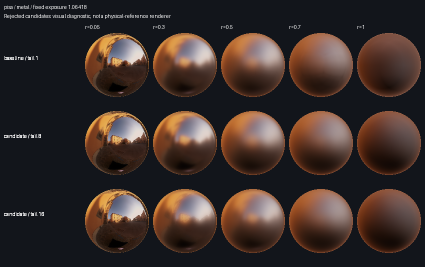
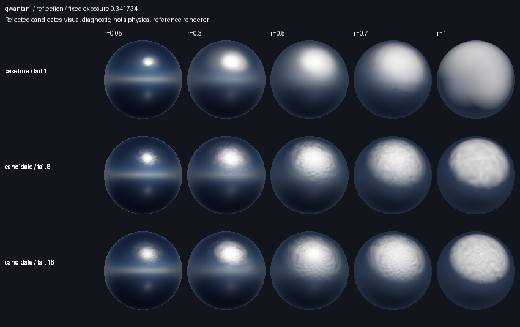

# IBL quality and bake efficiency acceptance

The subsequent [full-chain follow-up](sampling-encoding-acceptance.md) improves
BC6H single-texel encoding. Byte-parity claims below refer to the implementation
and binaries recorded in this report, before that later encoding repair.

## Decision

Ship reusable cubemap baking and the explicit specular minimum-size option.
Keep `auto = 1`, the existing source LOD formula, r-squared adaptive sampling,
1024 requested samples and medium quality defaults. All seventeen alternative
candidates failed a necessary quality gate; no default quality improvement is
claimed. Lambert filtering, UV box source mips and BRDF LUT production behavior
remain unchanged.

The optimization baseline is exactly
`8330953082f11ce9b0a7a0908b8ddfb3675deb4e`. Its release CLI SHA-256 is
`53fbe03865b5f6fb307a97690b08de7f2d9aa3862372a82a791981e0ee03b251`.
The implementation commit is `c7a393e`; its tested Windows CLI SHA-256 is
`6635976b7e523b0b9b2195e849c5eb23cb09841a51814828df87a8dace2a33d2`.
The private candidate exporter records its exact snapshot source hashes and
binary hash rather than pretending an uncommitted experimental build came from
a clean release commit. Its unmodified-policy Pisa output is byte-identical to
the frozen CLI in both formats.

## Delivered contracts

- `--specular-min-size <auto|positive integer>` and
  `BakeOptions::specular_min_size: Option<u32>` select a natural floor-halved
  output chain, freshly baked over the complete roughness range. `None`/`auto`
  have a fixed resolution of one, including small inputs. The explicit minimum
  must allow two levels for base sizes greater than one. Base one only supports
  its original single level. Internal source mips are independent of this option.
- Opaque `BakedCubemap` accepts file or six-face sources. IBLA and KTX2 encoders
  consume the same immutable linear pixels and calculate independent reports.
  CLI `both` filters each asset once, encodes sequentially and releases each
  encoded buffer after writing. Earlier successful outputs survive a later
  failure; warnings are emitted only for successfully written files.
- Consumers still use `LOD = r * (actualLevelCount - 1)`, or zero for one level.
  Upload every baked level, disable automatic mip generation, and configure the
  accessible mip range. No loader API or file-layout change is needed. Complete
  Rust option literals must add `specular_min_size: None`.

The normative details are in the [CLI README](../crates/ibl_cli/README.md#specular-levels),
[core README](../crates/ibl_core/README.md), and both loader READMEs. See also the
[unreleased migration notes](quality-optimization-release-notes.md).

## Quality evidence and rejection

The private [study tools](../scripts/quality-optimization/README.md) generate
constant HDR, continuous direction color, three rotated unit red/blue
hemispheres, wide/narrow lights at a face center, edge and corner, Pisa,
Footprint Court and Qwantani. Eighteen variants include the baseline, isolated
LOD/budget/request/tail changes and combinations of narrower LOD, linear budgets
and 8/16 tails. No source solid-angle reduction is introduced.

Generation covers all fourteen scenes at 128, and the three hemispheres at 256
and 512: 360 bakes. Independent full-grid reference evaluation covers all nine
hemisphere/size pairs, 76 fixed directions, roughness at 0.05 intervals and all
candidate adjacent-level midpoints. The 128/256/512 grids have 33/37/39 values.
Float, decoded RGBD and decoded BC6H outputs are evaluated separately.
The reference has exact azimuthal half-sphere coverage, f64 Gauss orders
128/256/512 and a closed-form r=1 endpoint. Unconverged low-roughness points stay
in the results, marked unqualified; they are never dropped to manufacture a
passing average. These are convergence diagnostics, not rigorous error bounds.

Worst floating-point final-sampling absolute error at r=1 across the three
hemispheres and fixed direction set:

| Policy | 128 | 256 | 512 | Required <=0.01 |
| --- | ---: | ---: | ---: | --- |
| Baseline, tail 1 | 0.213961 | 0.213961 | 0.213961 | Fails |
| Tail 4 alone | 0.038849 | 0.038846 | 0.038846 | Fails |
| Tail 8 alone | 0.028670 | 0.028668 | 0.028668 | Fails |
| Tail 16 alone | 0.026355 | 0.026353 | 0.026353 | Fails |
| Mean-area LOD, linear budget, 2048 request, tail 8 | 0.009194 | 0.009189 | 0.009189 | Endpoint passes |
| Same combination, tail 16 | 0.004382 | 0.005099 | 0.005099 | Endpoint passes |

Endpoint success is insufficient. For the third hemisphere at 128, r=0.125,
the fixed axes/edge/corner group has relative RMSE 0.010264 with the baseline,
0.035442 with the tail-8 combination and 0.047009 with tail 16. The permitted
increase is only 0.000513 (maximum of 5% baseline error, five reference envelopes
and 1e-4). This reference group is converged. The regression survives encoding:
RGBD for tail 8 goes from 0.010531 to 0.035642. A BC6H witness at 512, second
hemisphere, r=0.1 goes from 0.009407 to 0.028053. Reallocating fewer linear
roughness knots trades away interpolation accuracy even when the final level
has much better directional resolution.

An independent tail separation also shows why these are different problems.
For the second hemisphere at 128, the baseline's direct texel RMSE is 0.011800,
ideal 1x1-grid reconstruction RMSE is 0.082633, and actual sampled RMSE is
0.089638. The tail-8 combination gives 0.000524, 0.002058 and 0.002338
respectively. These quantities are not additive. This separation is established
for the analytic r=1 tail, not asserted as a complete attribution at every
roughness or for arbitrary HDR illumination.

Every alternative has a confirmed endpoint or qualified subgroup failure.
Therefore full HDR reference convergence and end-to-end timing of those rejected
algorithm combinations were not used as additional acceptance work. The
equal-scene 15% average improvement and two-scene/real-HDR 10% improvement gates
remain **unestablished**, not passed. The tools retain bounded HDR primary/local
cross-checks for subsequent experiments. No surviving subset is presented as an
overall quality improvement. The original rough-tail limitation remains in the
default output.

A one-direction Pisa r=1 smoke check exercised the on-demand primary integral
and local source-UV cross-check. It remained unqualified, confirming the bounded
tool preserves this outcome rather than declaring convergence from tool success.

## Fixed material review

Six cases have reflection, metal and dielectric sheets at r=0.05/0.3/0.5/0.7/1,
with a 128-pixel orthographic sphere, yaw 35 degrees, shared baseline LUT and
irradiance, and one fixed exposure per case. Linear RGB arrays and generation,
level, roughness and effective-sample metadata accompany the sheets. These
split-sum views are separate from the independent prefilter reference.

Pisa metal shows the changed roughness interpolation and rough-tail contrast:

The Qwantani reflection view shows visible sampling texture in the narrower-LOD
candidates, despite their better analytic endpoint. This observation is not a
claim that the baseline is physically exact:

## Encoding and process performance

All 27 production combinations pass the 2x median-time ceiling. The tests use
Windows, Intel Core i9-10940X, Rust 1.98.0 release binaries, four Rayon threads,
medium quality, 1024 requested samples, and all default targets (specular,
irradiance and LUT). Each combination has two warmups and seven alternating
baseline/candidate rounds. No confidence interval crosses the 2x gate, so no
fifteen-round extension is required. Windows Job Objects measure peak process
committed memory; this is not GPU memory or resident-set size.

| Scene / size | IBLA seconds (old → new) | KTX2 seconds (old → new) | Both seconds (old → new) | Candidate peak commit MiB (IBLA / KTX2 / both) |
| --- | ---: | ---: | ---: | ---: |
| Pisa / 128 | 0.631 → 0.639 | 0.607 → 0.617 | 1.188 → 0.680 | 14.2 / 14.4 / 14.3 |
| Footprint / 128 | 0.622 → 0.625 | 0.606 → 0.613 | 1.176 → 0.677 | 14.2 / 14.5 / 14.4 |
| Qwantani / 128 | 0.621 → 0.627 | 0.611 → 0.617 | 1.181 → 0.677 | 14.2 / 14.4 / 14.3 |
| Pisa / 256 | 1.490 → 1.502 | 1.401 → 1.417 | 2.800 → 1.618 | 29.8 / 29.8 / 29.8 |
| Footprint / 256 | 1.503 → 1.552 | 1.424 → 1.429 | 2.776 → 1.625 | 29.8 / 29.8 / 29.8 |
| Qwantani / 256 | 1.400 → 1.413 | 1.627 → 1.915 | 2.784 → 1.569 | 29.8 / 29.8 / 29.8 |
| Pisa / 512 | 4.660 → 4.663 | 4.272 → 4.324 | 8.871 → 5.216 | 97.7 / 97.7 / 97.7 |
| Footprint / 512 | 4.660 → 4.669 | 4.297 → 4.329 | 8.867 → 5.186 | 97.7 / 97.7 / 97.7 |
| Qwantani / 512 | 4.292 → 4.309 | 4.322 → 4.351 | 8.550 → 4.865 | 97.7 / 97.7 / 97.7 |

`both` takes 56.36–58.80% of baseline time (41.20–43.64% less time). Single-format
ratios span 1.0007–1.1766; the Qwantani 256 KTX2 slowdown is retained rather than
hidden in an average. Median peak-commit ratios range from 0.8601 to 1.0417.
All default assets, including irradiance and LUT, are byte-identical in every
performance pair, and their sizes are unchanged. For example, 512 `both` totals
3,779,214 bytes for Pisa, 4,151,939 for Footprint and 2,442,535 for Qwantani.
The [evidence JSON](quality-optimization-evidence.json) includes every raw timing,
memory sample, bootstrap interval, artifact size, hash and command.

Separate encoding diagnostics cover the constant environment and three HDRs at
128 for the baseline and the two pictured combinations. They compare decoded
texels against clamped float texels, independently of the loss from clipping.
The strong sun matters: baseline Qwantani has 13 RGBD-clipped pixels, a maximum
clipped component of 43,086.54, and whole-output clipping RMSE 113.328. The
tail-8 combination has four clipped pixels but RMSE 113.345; a smaller count does
not imply smaller radiance loss. BC6H has no range clipping here, but its
whole-output compression RMSE is 24.597 for the baseline. These are unweighted
stored-texel linear-RGB diagnostics, not normalized convolution errors.

The fixed sparse probes miss those clipped solar pixels and report zero sampled
clipping loss. Both facts are retained, with whole-output counts and loss preventing
that sampling omission from being mistaken for preserved HDR energy. No HDR
recovery multiplier or new encoding is introduced. RGBD reconstruction metrics
decode texels before interpolation; filtering encoded RGBD first can introduce
additional runtime error outside this CPU reconstruction model.

## Compatibility and validation

Default production outputs match the frozen baseline byte-for-byte for sizes
1, 3, 31 and 128, separately for IBLA, KTX2 and `both`. Actual TypeScript parsers
accept matching IBLA/KTX2 topology for `(base,minimum)` pairs `(1,1)`, `(3,1)`,
`(31,8)`, `(128,8)`, `(128,16)` and `(255,16)`. Six-face paths use the same core
route. Existing zero-as-one and low positive sample semantics remain covered at
all three quality settings.

Rust regressions cover the minimum-size constraints, normalized roughness after
rebaking, constant/finite/seam/orientation properties, format topology, shared
encoding identity, independent clipping and irrelevant-parameter behavior for
irradiance/LUT. A new BRDF check compares production importance sampling with
independent f64 light-hemisphere quadrature at three (NoV,roughness) pairs, checks
reference convergence below 1e-4, and requires agreement below 0.002. It does not
change the LUT model or encoding.

Windows format, Clippy, 121 Rust tests, TypeScript checks, both loader suites, site
build/tests and npm CLI tests pass. The npm suite skips its two POSIX signal
tests on Windows and runs the Windows Ctrl+C test. The initial loader run found
a missing old local KTX2 fixture; re-running with newly generated task-owned
fixtures passed. No consumer assets were refreshed. The local built site also
loaded actual 128-to-8 IBLA and KTX2 files, decoded all five levels, and displayed
their 8x8 tails; KTX2 completed zstd decoding and WebGPU BC6H preview. Screenshots
are retained with the local evidence. Fresh Linux/macOS CI results are not
established by these local checks. The existing CI workflow runs Linux quality and Windows/macOS Cargo
checks; those remote gates remain required before release.

## Historical release check (separate)

The actual Windows 0.2.3 release binary is verified against its saved release
archive/hash record. On decoded RGBD mip-zero resampling of continuous direction
color from 3-square source faces, RMSE improves from 0.020133 in the release to
0.010668 in the frozen optimization baseline; maximum error goes from 0.074326
to 0.030159. For 17-square source faces, RMSE goes from 0.001745 to 0.001438.
These values include projection and quantization and use the same fixed 76
directions. They corroborate existing cross-face repairs; they are **not gains
from this optimization** and do not establish a full historical HDR comparison.
The broader earlier study remains documented in
[Source Sampling Phase Two Acceptance](source-sampling-acceptance.md).

## Reproduction and retained evidence

All raw data, reference rows (including uncertainty), signed/linear visual arrays,
encoded assets, logs and per-level effective budgets remain in the ignored
`target/quality-optimization` directory. Follow the private tool README to
reproduce them; the study does not write into consumer asset directories. A
compact [evidence JSON](quality-optimization-evidence.json) accompanies this report. No release, runtime adapter,
nonlinear roughness mapping, repeated-size mip layout or GPU bake was introduced.
