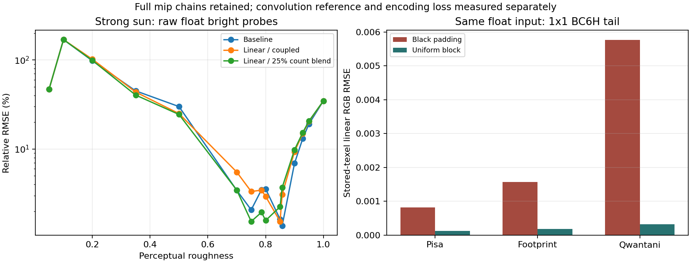

# Full-chain sampling and BC6H follow-up

## Decision and scope

Adopt uniform input blocks for BC6H 1x1 faces only. Keep the production
quadratic sample curve and coupled source-LOD footprint. Full linear sampling,
fixed-footprint controls, intermediate footprint budgets, stronger native encoder
presets, general edge padding and decoded-linear-RGB block optimization remain
experimental. The completed comparisons show confirmed subgroup regressions
despite useful average or floating-point gains.

This is an incremental encoding repair. It does not claim completion of the
earlier 15%/10% whole-algorithm adoption targets or the 1% rough-end target. The
existing one-texel tail's directional limitation remains. Default complete mip
chains, `auto = 1`, linear perceptual roughness-to-LOD mapping, IBLA v1, BC6H UFLOAT
+ zstd KTX2, clipping ranges and parser-only loader APIs retain their contracts.
No public configuration parameter, dependency or decoder API is added.

The baseline is `4398483`, which already includes shared baking. Its Windows
release CLI SHA-256 is
`6635976b7e523b0b9b2195e849c5eb23cb09841a51814828df87a8dace2a33d2`.
The production encoding candidate SHA-256 is
`308015c2185d20a0909aaeaafba1baa640b938d2d2af13a03ffeb6ea3988590a`.
Comparisons do not reuse the larger performance allowance implied by the older
pre-shared-bake baseline.

## Actual samples and source footprints

The [private tools](../scripts/sampling-encoding/README.md) build a source snapshot
of the frozen baseline and apply checked, private experiment hooks. They retain
the quality caps, size boosts, 1024 requested samples, medium quality, source box
mips, seam reconstruction and complete output chains. Production has no experiment
environment-variable interface.

| Policy | Actual sample curve | Source-LOD reference count |
| --- | --- | --- |
| Baseline | Quadratic | Quadratic |
| Samples only | Linear | Quadratic |
| Footprint only | Quadratic | Linear |
| Fully linear | Linear | Linear |

The source footprint is proportional to `1 / (referenceCount * pdf)`. Holding its
reference count fixed isolates the effect of changing actual samples; changing
the reference count with actual samples fixed isolates the footprint effect.
For a fixed PDF, the source LOD difference before clamping is
`-0.5 * log2(newReferenceCount / baselineReferenceCount)`.
The control fixes the count term, not an identical per-draw LOD: sample directions
and their PDFs still change when the Hammersley sequence length changes. Higher
counts do not simply append points to an unchanged sample sequence.

All four controls cover three rotated unit red/blue hemispheres at 128, 256 and
512, with constant/directional fields, six face/edge/corner lamp cases and three
real HDRs generated at 128. Additional controls retain linear actual samples but
interpolate the footprint count 25%, 50% or 75% toward the linear count, at 128.
Per-level dimensions, roughness, actual samples and footprint counts are recorded.
The factorial checks verify that paired controls change only the intended count,
all retained levels form a complete natural chain, budgets stay <=1024, and mip
zero is bit-identical. Baseline floating outputs match the earlier study byte for
byte for all nine hemisphere/size pairs.

For example, the first filtered 128-size level uses 136 actual/reference samples
in the baseline. The samples-only control uses 183 actual samples and the same
136 footprint samples; the fully linear control uses 183 for both. None of these
numbers is a new CLI option.

## Independent HDR reference

The real-HDR reference integrates the entire reconstructed projected mip-zero
source in cube UV, split at bilinear knots, with the cube's solid-angle Jacobian.
It uses the normalized N=V GGX kernel in f64, without production Hammersley
samples, source mips or FIS LOD. Its target is the shared 128-square projection,
not an exact integration of the original latlong image or a full material renderer.

Each HDR has 103 fixed directions: the earlier 76 probes plus 27 probes around
three distinct bright source regions. Orders 2/4/6 provide successive quadrature
checks; low-roughness kernel neighborhoods use higher local orders. The diagnostic
requires both successive RGB changes relative to reference RMS and the error in
the analytic unit kernel normalizer to be <=1e-4. A constant-HDR/normalizer check
also passes independently.

The initial seven-roughness run retained 59 unqualified queries. Refining only
those queries with orders 4/6/8 established convergence, retaining the original
results and every refinement level. That coarse query set was insufficient:
general edge padding initially had no confirmed regression, but affects every
query interpolating into the partial tail levels, starting above r=5/7 at 128.

The reference therefore adds all affected 0.05-spaced queries, adjacent-level
midpoints and the affected stored knot. The complete tested roughness set is
0.05, 0.1, 0.2, 0.35, 0.5, 0.7, 0.75, 11/14, 0.8, 0.85, 6/7, 0.9, 13/14, 0.95
and 1. Eight additional strong-sun directions required refinement and also
converged. Final Pisa, Footprint and Qwantani reference rows all qualify:
3 scenes * 15 roughnesses * 103 directions = 4635 queries.

These observed convergence checks are not rigorous global error bounds.
Low-roughness uncertainty in the separate analytic hemisphere reference remains
recorded rather than discarded. Scene means are unweighted means of this
nonuniform query set, including uncertain rows where present; they are not
uniform-roughness or global-average gains and do not establish the earlier 15%
adoption target.

## Sampling findings

The floating-point hemisphere gain from fully linear sampling is largely due to
its narrower source footprint. With the footprint held fixed, increasing samples
alone has both improvements and converged regressions. The footprint-only control
also has HDR regressions: sample coverage matters for the strong sun.

Fully linear sampling has no over-tolerance floating subgroup regression in the
nine hemisphere/size pairs, but the denser HDR reference reveals twelve. At Qwantani 128,
r=0.7, the bright group's floating relative RMSE rises from 0.034364 to 0.055114;
the tolerance is 0.001718. RGBD similarly rises from 0.034040 to 0.055363. These
results are converged and cannot be attributed to BC6H compression.

The 25% footprint control initially had no confirmed floating or RGBD regression
on the seven HDR roughnesses. Adding the tail queries exposes fourteen floating
subgroup regressions. It also fails encoded checks: at Pisa r=0.7, its general
edge-padding BC6H bright-group error increases from 0.040999 to 0.047078, against
a tolerance of 0.002050. It has not earned adoption or an all-size quality claim.

| Control | Floating regressions, nine hemisphere/size pairs | Floating regressions, three HDRs at 128 |
| --- | ---: | ---: |
| Linear actual count, fixed quadratic footprint | 41 | 17 |
| Quadratic actual count, linear footprint | 1 | 18 |
| Fully linear | 0 | 12 |
| Linear actual count, 25% footprint count blend | 0 at 128 only | 14 |

Counts are overlapping qualified case/roughness/direction-group failures, not
counts of distinct images. The tolerance remains the maximum of 5% of baseline
error, five times reference uncertainty and 1e-4 normalized error.

Thus the current experiment supports separating bias, finite-sample coverage and
encoding loss. A reduction in average convolution error does not establish
uniform improvement across bright regions and roughness values.

## BC6H findings and adopted repair

Isolated encoding comparisons use identical saved floating pixels. They include
basic, slow, very-slow, targeted-small-level search, extra endpoint refinement
and fast-mode controls, with black or nearest-edge padding. Slower presets reduce
some average encoding errors but are not monotonic improvements in the final
convolution-reference groups. The additional native presets are analytic screening
controls; the complete three-HDR comparisons cover basic, slow and the decoded-RGB
variants. Untested preset/HDR combinations are not marked as passing.

The experiment also refines BC6H indices using decoded linear RGB, preserves
endpoints/modes and anchor-bit restrictions, and selects blocks from a candidate
portfolio. Its per-block valid-texel SSE never exceeds the retained basic fallback.
This still does not guarantee lower error after cubemap reconstruction against
the independent convolution reference. Both techniques remain private experiments;
the production writer remains write-only.

General nearest-edge padding reduces stored-texel RMSE, aggregated over partial
levels, by 4.8% to 99.8% in the tested scene/base pairs. Nevertheless, it fails four
strong-sun bright-group queries at r=0.75, 11/14, 0.8 and 0.85. At r=0.8 the
relative error rises from 0.021517 to 0.028183, beyond the 0.001076 tolerance.
These queries interpolate into the spatially varying 2x2 level. The slow native
preset and the decoded-RGB portfolio do not remove these failures. General
partial-block padding remains experimental.

The accepted standalone change fills the entire 4x4 encoder input of a 1x1 face
with its sole valid color. A 1x1 face has no within-face spatial variation. Every
other size, including 2x2 and NPOT boundary blocks, retains the original padding.
The private level-splicing control isolates this change before production
implementation. Non-1x1 payloads stay byte-identical; output dimensions,
ceil-divided block counts and range-report pixel counts are unchanged.

Across 32 tested scene/base pairs, the 1x1 stored-texel RMSE decreases by 50.4% to
99.8%. This measures encoding error against identical clamped floating pixels,
not physical integration. For the default 128 chain's final 1x1 level:

| Source | Black-padding RMSE | Uniform-block RMSE |
| --- | ---: | ---: |
| Pisa | 0.00081946 | 0.00012044 |
| Footprint | 0.00157213 | 0.00018654 |
| Qwantani | 0.00576462 | 0.00032702 |

The accepted change has zero over-tolerance qualified subgroup regressions in
the nine hemisphere/size pairs and three HDR reference cases. It does not improve
every metric: sampled HDR scene means rise slightly (0.00007–0.00022 relative
RMSE on this query set), within the existing subgroup tolerances. Source/filter floats and
IBLA/LUT bytes are unchanged. The complete original rough-end spatial error is
not solved by making compressed texels more faithful. Lower encoding error can
remove favorable cancellation with an existing convolution/reconstruction error;
the final-query checks therefore remain necessary.

## Performance

The production repair passes all 27 cells: three HDRs, 128/256/512, and
IBLA/KTX2/both. Median end-to-end ratios against the frozen baseline are:

| Format | Minimum ratio | Maximum ratio | Total artifact byte change |
| --- | ---: | ---: | ---: |
| IBLA | 0.9969x | 1.0054x | 0 |
| KTX2 | 0.9938x | 1.0057x | +15 to +24 |
| Both | 0.9949x | 1.0056x | +15 to +24 |

Maximum observed peak process commit is 97.828 MiB for baseline and 97.832 MiB
for the repair; per-cell memory samples and medians are retained in the evidence.
The small compressed-size increase reflects different block bytes; level lengths
before zstd and logical geometry retain their contracts.

The rejected fully linear candidate additionally passes the time ceiling in nine
strong-sun cells using a static implementation without experiment hooks. Ratios
range from 1.1761x to 1.3688x, with the largest 95% bootstrap upper limit 1.3761x.
Observed peak process commit is 97.781 MiB for its baseline runs and 97.738 MiB
for linear runs. Artifact byte changes are +45 to +1233 for IBLA, -253 to +180 for
KTX2, and +196 to +980 for both. This is diagnostic timing of a rejected quality
candidate, not a complete all-scene performance certificate for a new default.

The earlier instrumented linear timings, retained with the rejected full-edge
candidate, were inflated by private footprint dispatch inside the sample loop.
They are not used to judge production algorithm cost. The final static binary
hash and its source/encoder hashes are retained in the evidence.

All commands include the default specular, irradiance and LUT targets, medium
quality, 1024 samples and four Rayon threads, with two warmups and seven alternating
rounds. The ceiling is 2x against the shared-bake baseline. Peak process committed
memory and artifact sizes are retained separately.

The [compact numerical evidence](sampling-encoding-evidence.json) records
reference convergence, qualified failures, per-level encoding/clipping errors,
actual sample budgets, binary/source identities, timing samples, memory and
artifact sizes. Large raw arrays and full original/refinement traces stay in the
hashed local research directory.

## Validation and limits

All 122 Rust tests pass, including the new invariant that a 1x1 face encodes
identically to the same uniform full block. Format/Clippy, TypeScript checks,
18 IBLA parser tests, 20 KTX2 parser tests, six site tests/build and five applicable
npm CLI tests pass; the two POSIX signal tests are skipped on Windows.

Actual production outputs at sizes 1, 3, 5, 31, 128 and 255, plus truncated
(128,8) and (255,16), pass both real parsers. IBLA, irradiance IBLA and LUT remain
byte-identical to baseline; the aligned truncated 128-to-8 KTX2 is also identical.
All non-1x1 compressed level payloads match baseline. Production blocks match the
private quality-tested control at sizes 1, 3, 31, 128 and 255; the static linear
candidate's 128 HDR IBLA bytes also match its private sampling control.
The encoding study includes constant, directional and Pisa inputs at base sizes
1, 3, 31 and 255. No consumer assets are overwritten and no release is published.
Fresh Linux/macOS CI remains a release gate; local Windows results do not replace it.

The HDR reference covers 128, while the hemisphere reference covers all three
production sizes. Unqueried lower-roughness HDR intervals and 256/512 HDR reference
integration remain unestablished. The adopted encoder change cannot affect the
lower intervals before interpolation into the 1x1 level: its other payloads are
unchanged. This scope is sufficient to reject the linear
defaults that already fail converged checks; it is not a claim of universal
sampling or compression optimality.

## Next research boundary

More samples alone and a narrower FIS footprint are not sufficient to establish
robust gains on narrow HDR emitters. A useful next experiment would improve
environment coverage or directly integrate the small number of coarse-tail
output directions, retaining the current roughness nodes and formats. It should
first beat the converged strong-sun bright groups with a fixed footprint, then
measure the same process-time ceiling.

Any further BC6H search should also evaluate the reconstructed cubemap and
roughness interpolation, rather than assuming a per-block RGB SSE minimum will
preserve the floating convolution improvement. These are separate follow-ups,
not additional public knobs or completed optimizations in this change.
